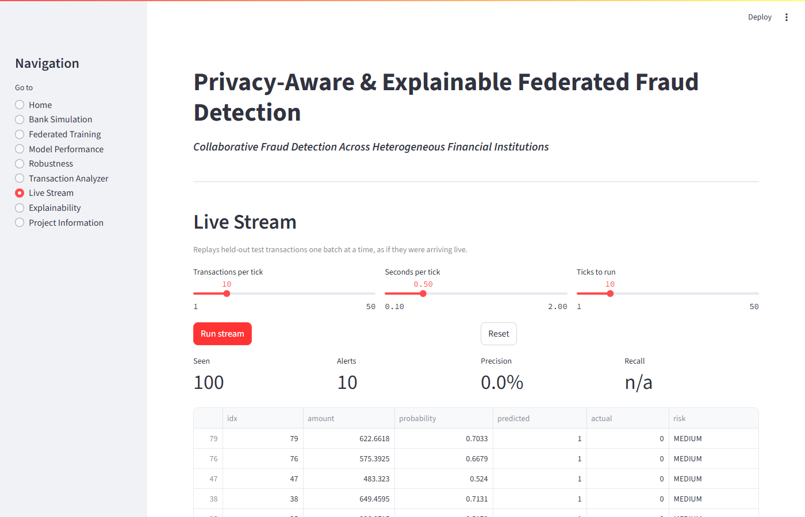
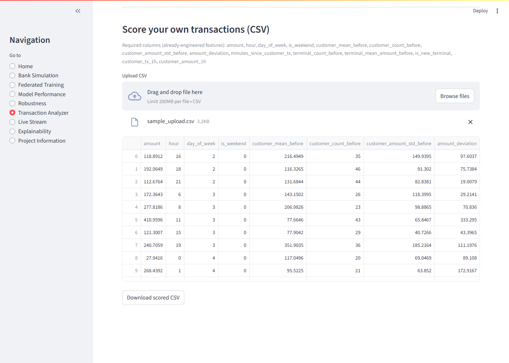
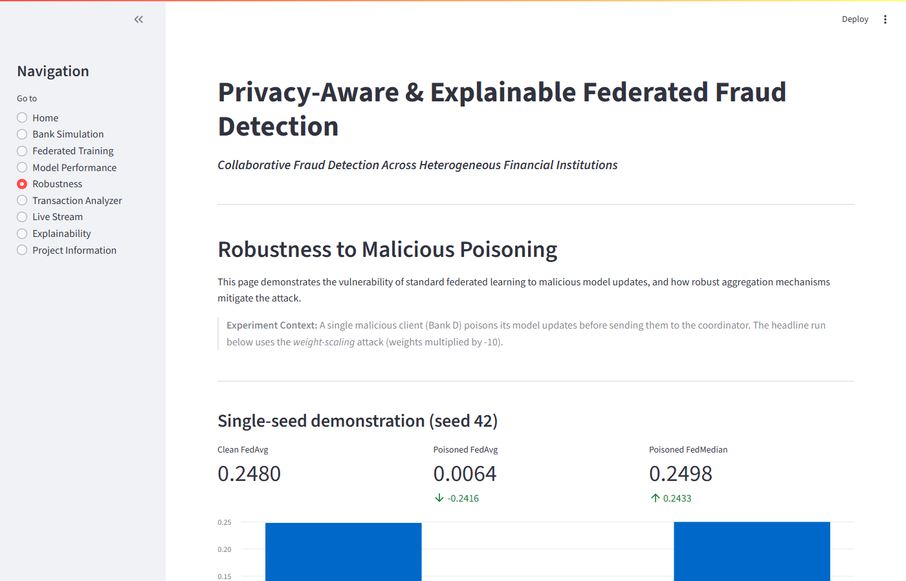
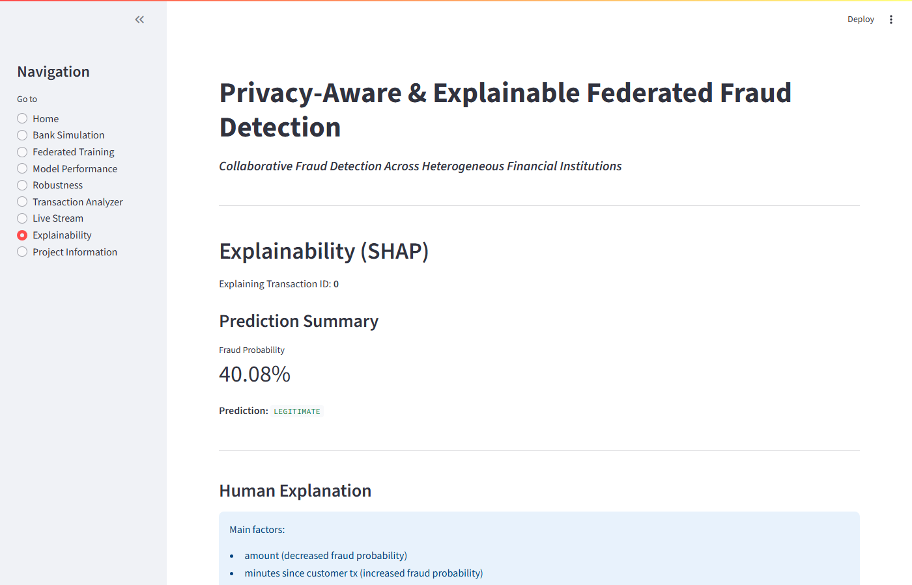

# Privacy-Aware & Explainable Federated Fraud Detection

[](https://github.com/STUDIOUS-dev/federated-fraud-detection/actions/workflows/tests.yml)
 

**TL;DR:** four simulated banks train a fraud model together without sharing raw transactions. Federation matches pooled training; a single poisoned client collapses plain FedAvg (PR-AUC 0.80 -> 0.29 on real credit-card data) while median aggregation holds at 0.81. Includes SHAP explanations, a Streamlit dashboard with a live-stream replay, and a FastAPI scoring service.

| Live Stream replay | Score your own CSV |
|---|---|
|  |  |
|  |  |

## Overview
I built this project to study how federated learning (FL) can be used for fraud detection across heterogeneous banks. My goal was to see if multiple independent financial institutions could collaboratively train a machine learning model while keeping their raw customer transaction data local. 

## Problem
Detecting financial fraud requires large, diverse datasets. However, banks may face privacy, security, governance, and competitive constraints when sharing raw customer transaction data. This creates isolated "data silos," limiting the performance of any individual bank's fraud detection system. I wanted to explore how federated fraud detection could bridge this gap by allowing banks to learn from each other's fraud patterns while preserving data privacy.

## Key Features
I implemented and tested several core features throughout this project:
- **Heterogeneous bank simulation**: I generated synthetic transaction data simulating four different banking profiles (e.g., retail-heavy vs. high-value transactions).
- **Centralized & local baselines**: I built baseline PyTorch models to compare FL against a centralized reference baseline and isolated silos.
- **Federated algorithms**: I integrated Flower (`flwr`) to experiment with `FedAvg`, `FedProx`, `FedMedian`, `FedTrimmedAvg` and `Krum` aggregation strategies.
- **Poisoning experiments**: I introduced malicious clients (three attacks: weight `scale`, `signflip`, `labelflip`) to study model collapse and robustness under data-poisoning attacks.
- **SHAP explainability**: I added SHAP to provide human-readable, localized feature attribution for individual transactions.
- **Streamlit dashboard**: I created an interactive web application to visualize the frozen experiments and dynamically analyze transactions.
- **Live Stream page**: replays held-out transactions in batches with running alerts, precision and recall.
- **CSV scoring**: upload engineered-feature transactions in the Transaction Analyzer and download scored results.
- **Scoring API (FastAPI)**: `POST /score` returns fraud probability, risk level and optional SHAP explanation.
- **Real-data study**: the same federated comparison on the public OpenML credit-card dataset, with its own dashboard page.

## Architecture
```text
+---------------------------+
|      Global Server        |
| FedAvg / FedProx /        |
| FedMedian / FedTrimmedAvg |
| / Krum                    |
+-------------+-------------+
              |
      +-------+-------+-------+-------+
      |       |       |       |       |
   Bank A  Bank B  Bank C  Bank D
   Local   Local   Local   Local
   Model   Model   Model   Model
      |       |       |       |
 Local Data Local Data Local Data Local Data
```
For the backend architecture, I used PyTorch to build a Tabular Multilayer Perceptron (MLP) and orchestrated the federated learning simulation using `flwr` (Flower). I then built a Streamlit application that acts as an interactive dashboard, allowing users to explore the final frozen models and evaluation results.

## Technology Stack
- **Python**: Core logic and scripting
- **PyTorch**: Deep learning backend
- **Flower (`flwr`)**: Federated learning orchestration
- **SHAP**: Explainability and feature attribution
- **Streamlit**: Web dashboard interface
- **FastAPI / Uvicorn**: Scoring API
- **Docker** and **GitHub Actions**: container image and CI
- **Scikit-Learn / Pandas / NumPy**: Data processing and metric evaluation
- **Pytest**: Automated testing framework

## Project Structure
Here is how I structured the final repository:
```text
.
├── configs/             # Configuration files for FL rounds, architecture, etc.
├── data/                # Data generation output (local-only/ignored)
├── docs/                # Project documentation and guides
├── results/             # Validated outputs, final metrics, and frozen checkpoints
├── .github/workflows/   # CI (pytest)
├── Dockerfile           # Scoring API image
├── scripts/             # Helper scripts: run all experiments, acceptance/smoke tests, report generator
├── src/
│   ├── app/             # Streamlit dashboard pages and state
│   ├── experiments/     # Reproducible FL scripts (Exp 1-10, multi-seed `study.py`)
│   ├── api.py           # FastAPI scoring service
│   ├── federated/       # Flower clients and custom strategies (FedAvg, FedProx, FedMedian, FedTrimmedAvg, Krum)
│   └── services/        # Abstraction layer mapping core FL to UI components
├── tests/               # Pytest suite
├── README.md
└── requirements.txt
```

## Installation

### Windows
```powershell
python -m venv venv
.\venv\Scripts\Activate.ps1
pip install -r requirements.txt
# If flwr[simulation] requires Ray and you face dependency issues with protobuf:
pip install "ray[default]"
```

**Ray is optional.** The dashboard, the scoring API, the test suite and the multi-seed study (`python -m src.experiments.study`) do not need Ray. Only the Ray-based single-seed experiments (exp3-exp10, e.g. via `scripts/run_all_experiments.py`) need the simulation extra: `pip install "flwr[simulation]"`.

### Linux / macOS
```bash
python3 -m venv venv
source venv/bin/activate
pip install -r requirements.txt
```

## Run the Product
To launch the interactive demonstration dashboard that I built:
```bash
streamlit run src/dashboard.py
```

## Scoring API
```bash
uvicorn src.api:app --port 8000      # interactive docs at http://localhost:8000/docs
```
```bash
curl -X POST localhost:8000/score -H "Content-Type: application/json" -d '{"transactions":[{...14 features...}],"explain":true}'
```
Each transaction needs the 14 engineered features listed in `src/feature_engineering.py` (`BASE_FEATURES`). Docker: `docker build -t fraud-api . && docker run -p 8000:8000 fraud-api`.

## Run Tests
To validate the current integrity of the codebase:
```bash
python -m pytest -v
```
An opt-in test compares the Ray-free in-process runner with the Flower/Ray simulation (exact match for FedAvg; the client-dropout case is a documented expected failure). It is skipped unless Ray is installed and enabled:
```bash
pip install "flwr[simulation]"
RUN_RAY_TESTS=1 python -m pytest tests/test_inprocess.py -v     # takes a few minutes; FL_NUM_CPUS=2 limits Ray
```

## Research Experiments
The original ten experiments (`src/experiments/exp1_*` ... `exp10_*`) are single-seed (seed 42) demonstrations; their outputs and model checkpoints are in `results/` and are what the dashboard shows. To regenerate all of them (takes ~20 minutes; Flower + Ray):
```bash
python scripts/run_all_experiments.py --yes   # --yes is required: it DELETES results/summary.jsonl and overwrites the frozen results
python -m src.experiments.exp4_fedprox     # or one at a time
```

Because single seeds are noisy (the test pool has only ~53 fraud cases), the headline results come from a **multi-seed study**: 38 scenarios x 5 seeds, every scenario scored on the same reference test pool. It uses an in-process runner that drives the same clients and strategies as Flower (verified identical to the Flower/Ray simulation when no client drops out; with client dropout the two runners drop different banks, so results agree only statistically), so it finishes in about an hour instead of many.
```bash
python -m src.experiments.study                 # resumable; writes results/study/ and docs/STUDY_RESULTS.md
python -m src.experiments.study --only attack   # a subset (regex on scenario name)
python -m src.experiments.study --report-only   # rebuild the report from results/study/runs.jsonl
```

## Final Results
Global PR-AUC, mean ± std over 5 seeds (full tables, per-bank results and paired tests: [docs/STUDY_RESULTS.md](docs/STUDY_RESULTS.md)):

| Configuration | PR-AUC | Recall @ 1% FPR |
|---|---:|---:|
| Centralized | 0.309 ± 0.075 | 0.378 ± 0.064 |
| Local-only (avg) | 0.292 ± 0.070 | 0.374 ± 0.073 |
| FedAvg | 0.300 ± 0.069 | 0.379 ± 0.076 |
| FedProx (mu=0.01) | 0.300 ± 0.069 | 0.379 ± 0.076 |
| FedAvg, 1 of 4 clients scaling weights x -10 | 0.098 ± 0.130 | |
| FedMedian, same attacker | 0.300 ± 0.070 | |

What the data supports:
- Federation matches pooling the data and beats isolated training by a small, consistent margin (+0.008 PR-AUC, 5/5 seeds); the gain is large for banks with little data or fraud (+0.07 PR-AUC in the extreme-imbalance scenario).
- IID vs non-IID data, FedProx (mu up to 0.1) and client dropout (up to 50%) made no measurable difference in this synthetic setting.
- FedAvg is clearly vulnerable to a weight-scaling attacker; FedMedian, trimmed mean and Krum all neutralise one attacker of four. With two of four malicious, median and trimmed mean fail; Krum survives only under favourable assumptions (see the caveats in the study report).
- Absolute accuracy is modest (F1 about 0.04 at threshold 0.5) because the synthetic fraud signal is weak.

### Real-data check (OpenML creditcard, 5 seeds, 4 simulated banks)
Separate from the synthetic study; see [docs/REAL_DATA_RESULTS.md](docs/REAL_DATA_RESULTS.md). Reproduce with `python -m src.experiments.real_data_study` (downloads ~150 MB once).

| Setup | PR-AUC |
|---|---:|
| Centralized | 0.798 ± 0.008 |
| Local-only (avg) | 0.791 ± 0.005 |
| FedAvg | 0.803 ± 0.010 |
| FedMedian | 0.806 ± 0.006 |
| FedAvg + 1 scaling attacker | 0.287 ± 0.272 |
| FedMedian + 1 scaling attacker | 0.806 ± 0.006 |

The test split has only 75 frauds, so differences between healthy methods are within noise; the attack result is not.

## Explainability
SHAP provides localized feature attribution, which allows the dashboard to generate human-readable explanations of which transaction features contributed most to the model's fraud probability score. These are model attributions, not causal explanations.

## Limitations
- **Synthetic data** in the main study with a weak fraud signal and about 53 fraud cases in each test pool; per-bank results are very noisy.
- **Simulated banks** on one machine; no real network latency or bandwidth measured.
- **No Differential Privacy** and **no Secure Aggregation**; model updates could leak information (e.g. gradient inversion).
- **Limited attacks:** three simple, non-adaptive poisoning attacks, at most 2 of 4 clients.
- Only mild heterogeneity between banks, so null results for IID-ness and FedProx may not carry over to real data.
- The real-data "banks" are a random, skewed partition of one public dataset (row order stands in for time), not separate institutions.
- The API and CSV upload expect already-engineered features; raw transactions need the rolling customer/terminal history computed first.
- **Velocity features are nearly dead:** the synthetic generator draws each customer's transaction times from a range of 5,184,000 minutes (about 10 years) instead of 60 days, so the 1-hour velocity features (`customer_tx_1h`, `customer_amount_1h`) are almost always zero (about 0.03% of rows non-zero) and contribute almost nothing. This is left as is because changing it would invalidate the frozen results.
- **Pooled scaler:** the feature scaler is fitted on the pooled training data of all banks, which a real federation would have to replace with per-bank or securely aggregated statistics.
- Not a production system.

## Future Work
Differential privacy and secure aggregation; adaptive and colluding attackers; raw-transaction feature pipeline for the API; communication-cost analysis.
